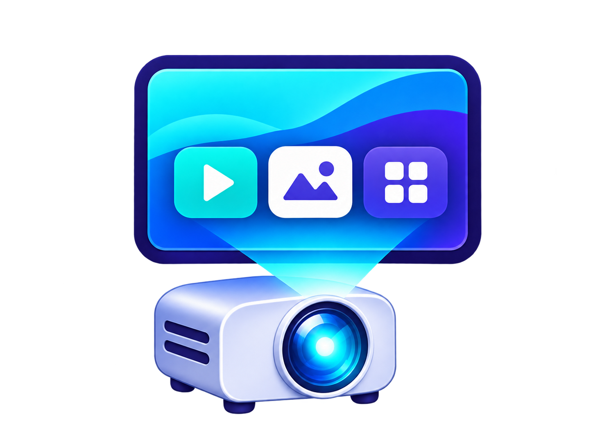
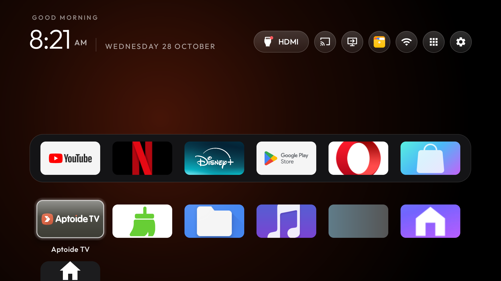

# CleanYourTV for Magcubic HY320 Pro

  
# CleanYourTV for Magcubic HY320 Pro

An Apple TV inspired Home based on [CleanYourTV](https://github.com/Gathin23/cleanyourtv),
with a dock, app library, expanding shortcuts and local appearance options.
The default branch builds two editions that work with **debugging switched off after setup**.

| Edition | Home | Settings | Persistent ADB/helper |
|---|---|---|---|
| Basic | Custom Home; simple launcher preferences | Stock manufacturer settings | None |
| Advanced | Same Home and appearance options | Eight styled sections; direct supported controls and stock-page fallbacks | None |

Advanced keeps volume/mute, quiet hours, appearance, backup/restore of the look, Bluetooth search and
paired-device listings, Wi-Fi status/scanning, application information and chosen-folder browsing.
Projection adjustments, Bluetooth power/connection management, Wi-Fi configuration, manual clock,
language, keyboard management, app administration and manufacturer maintenance use normal stock
screens. Automatic time/time zone and three system preferences are optional direct controls with
documented one-time access; they fall back to system settings when access is absent.

Basic remains the simple Home/stock-settings edition. Advanced retains the redesigned settings
interface without a settings broker, local ADB transport, pairing client, native projector writer,
debugging switch writer or startup companion. Neither APK declares INTERNET.

The helper-enabled full-control implementation is named **Ultimate** and is maintained separately
on the [`ultimate` branch](https://github.com/KeyErrorFinn/cleanyourtv-magcubic-hy320pro-launcher/tree/ultimate).
It is not part of this branch's builds or setup. [Edition comparison and switching](docs/hy320pro/EDITIONS.md).

Original development capture; current edition separation still needs physical verification.
Installed app artwork belongs to its respective owners.

## Device and setup

Original observed unit: Magcubic HY320 Pro, Android 14 / SDK 34, `Projector_20260713.153921`,
`rk3566_rgo`, `exdroid`, 32-bit ARM, about 1 GB RAM. Source also recognises
`Projector_20261014.163241`; recognition does not establish equivalent physical verification.
HY320, HY320 Mini, HY300 and HY300 Pro are not established compatible.

1. Read the [device guide](docs/device.md) and [compatibility limits](docs/hy320pro/COMPATIBILITY.md).
2. [Build from source](docs/hy320pro/BUILD.md). Current source is version 1.3.0; existing v1.0.1
   prerelease assets predate this split and must not be described as helper-free Advanced.
3. Follow [installation](docs/hy320pro/INSTALL.md), back up your own unit, install manually first,
   test, then select Home separately. Keep stock MagcubicOS installed and enabled.
4. Advanced: use the [permission guide](docs/hy320pro/PERMISSIONS.md) only for desired optional controls.
5. Switch debugging off after setup, remove unused computer pairings and verify the used ports.

No root, flashing, factory menu, system-partition modification, silent package disabling, Google
services, streaming APKs, subscriptions, accounts or another owner's calibration are included.
The ChromeCast shortcut opens separately installed AirScreen; it is not certified Chromecast built-in.

## Appearance and recovery

Default six-slot dock: YouTube, Netflix, Disney+, Play Store, Opera and App Store where installed.
Missing applications are not installed automatically. Basic uses stock Settings and has launcher
preferences on hold-Settings; Advanced uses Other settings → Appearance. Both share the package ID
and signing identity, so only one edition installs at once.

[Configuration](docs/CONFIGURATION.md) · [Basic profile](profiles/basic/README.md) ·
[Advanced profile](profiles/advanced/README.md) · [Seasonal themes](docs/hy320pro/SEASONAL.md) ·
[Restore](docs/hy320pro/RESTORE.md) · [Validation](docs/hy320pro/SOURCE-VALIDATION.md) ·
[Publication checklist](docs/hy320pro/PUBLICATION.md)

Current checks do not replace tests of the physical remote, projection, HDMI/audio, boot and wake.
Backups are not firmware backups and do not guarantee recovery from boot failure.

## Source

CleanYourTV source: [MIT](LICENSE). Outfit font: [OFL](FONT-LICENSE-OFL.txt).
[Other notices](NOTICE.md). No analytics or telemetry are added. Local settings and appearance
backups remain on the device; browsing uses only the folder explicitly chosen by the user.
The upstream [contribution fork](https://github.com/KeyErrorFinn/cleanyourtv-magcubic-hy320pro-launcher-contrib)
contains only contribution documentation, not this implementation. Upstream has not approved a release.
