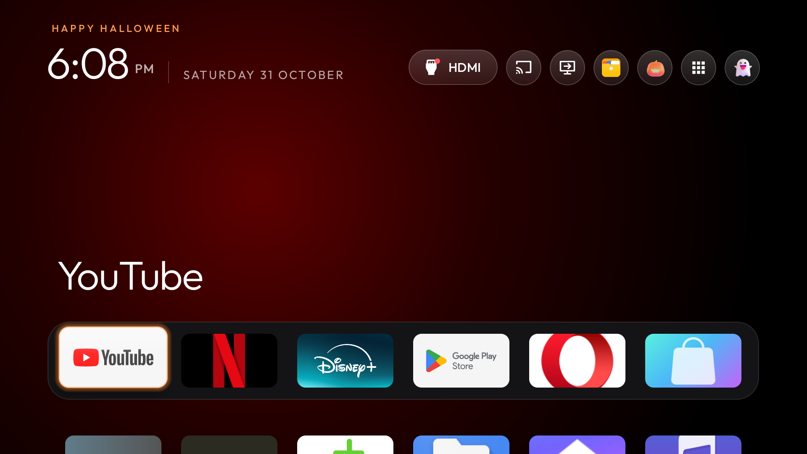

# Seasonal themes

Home can dress up for six holidays: **New Year, Valentine's Day, St. Patrick's Day, Easter, Halloween and
Christmas**. Each one changes:

- **The wallpaper.** A scene for the holiday (a haunted house under a full moon, snowy pines, fireworks over a
  city, Easter eggs on a hillside, drifting hearts, a rainbow over green hills). The scenes are drawn in code, not
  stored as pictures, so they add nothing to download and have no licence terms. If you have chosen your own
  wallpaper, it stays and the scene is not drawn.
- **The dock.** The band behind your dock apps becomes tinted glass with a rim in the holiday's colour. This goes
  with the scene, so it also stays as it is when you use your own wallpaper.
- **The pill icons.** The network and Settings pills get pictures for the holiday, with a short motion when focused.
  The Inputs pill keeps its HDMI signal icon, so you can still see at a glance whether a source is connected.
- **The greeting and focus glow** ("Merry Christmas", in the holiday's colour).
- **A short fall** of snow, confetti, hearts, shamrocks, blossoms or bats the first time Home opens each day.

Your apps and layout are left alone. With reduced motion on, the icons are still and the daily animation is
skipped. Nothing is downloaded and the launcher gains no permission.

Home on 31 October with Automatic selected: the greeting, the focus glow and the network and Settings pills change; the HDMI indicator stays.

Advanced edition: Settings, Other settings, Appearance. Seasonal themes sits under Look.

## Choosing

| Setting | What Home does |
|---|---|
| **Automatic** | Each holiday shows on its own dates, and Home goes back to normal in between. |
| **Off** | No seasonal skin. |
| **Always &lt;holiday&gt;** | That holiday's skin stays until you change it, whatever the date. |

**Advanced edition:** Settings, Other settings, Appearance, **Seasonal themes**. It defaults to **Automatic**. Home updates when
you leave Settings.

**Basic edition:** it is an optional extra and **off by default**. Settings opens the manufacturer pages, so there is
no menu; turn it on by editing the default or pushing a theme.

- In a build of your own, set `seasonal_mode` in `app/src/main/res/values/config.xml` to `auto` or a holiday name.
- Or put `"seasonal": "auto"` (or `"christmas"`, and so on) in a theme's `config.json`.

A saved Settings choice (Advanced) beats the theme, and the theme beats `config.xml`. An unrecognised value is
ignored. A festival a theme names itself (`"festival"`, for example Diwali, with its end date) still wins while it
runs.

## Dates in Automatic mode

| Holiday | Shows | Names for `config.xml` and themes |
|---|---|---|
| New Year | 27 December to 2 January | `new_year` |
| Valentine's Day | 7 to 14 February | `valentines` |
| St. Patrick's Day | 10 to 17 March | `st_patricks` |
| Easter | The 9 days before Easter Sunday, through Easter Monday | `easter` |
| Halloween | 15 October to 1 November | `halloween` |
| Christmas | 10 to 26 December | `christmas` |

Easter is worked out for each year with the Gregorian (Western churches') calendar, so Orthodox Easter can differ.
If an early Easter overlaps St. Patrick's week, St. Patrick's Day keeps its days and Easter follows. Dates use the
projector's own date, so set the date and time zone correctly.

## Credits

The holiday pictures are from Microsoft's Fluent Emoji (MIT); see
[ICONS-LICENSE-FLUENT-EMOJI.txt](../../ICONS-LICENSE-FLUENT-EMOJI.txt). The Halloween pictures and bat flight come from
the upstream CleanYourTV launcher's Halloween skin.
