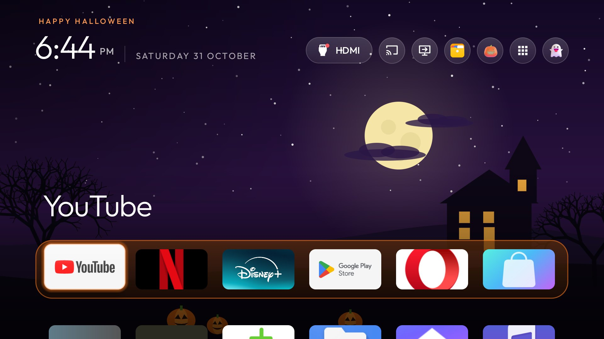
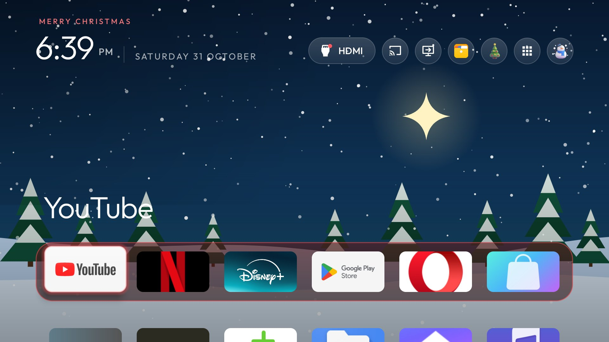
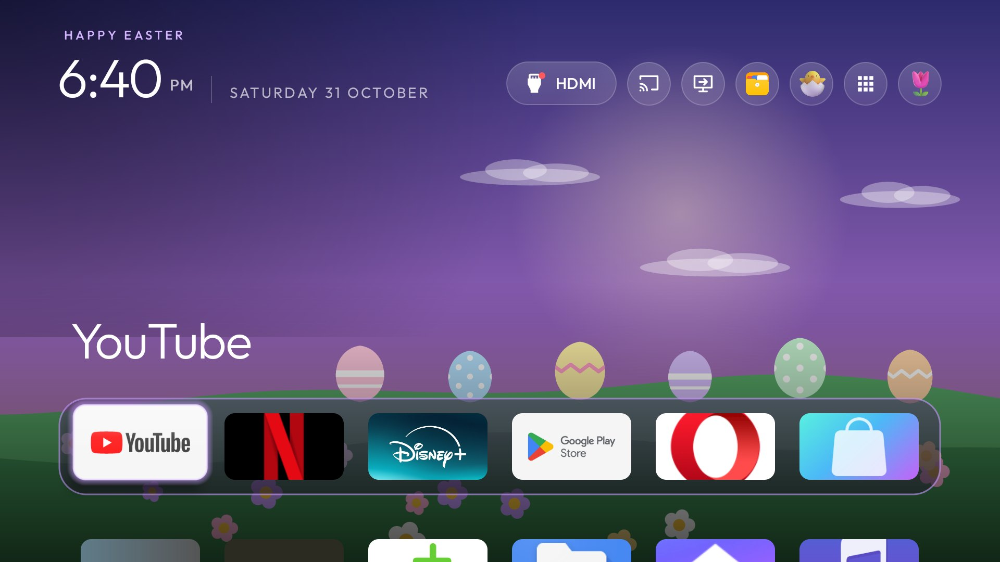
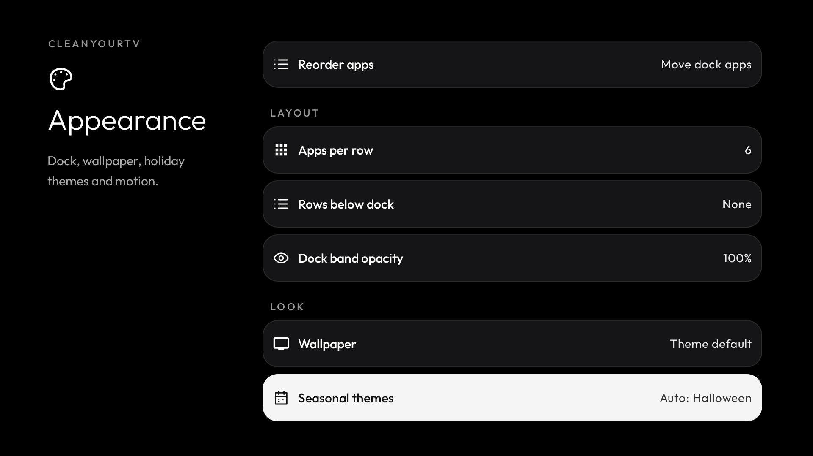

# Seasonal themes

Home can dress up for six holidays: **New Year, Valentine's Day, St. Patrick's Day, Easter, Halloween and
Christmas**. Each one changes:

- **The wallpaper.** A scene for the holiday (a haunted house under a full moon, snowy pines, fireworks over a
  city, Easter eggs on a hillside, drifting hearts, a rainbow over green hills). The scenes are drawn in code, not
  stored as pictures, so they add nothing to download and have no licence terms. If you have chosen your own
  wallpaper, it stays and the scene is not drawn.
- **The dock.** The band behind your dock apps becomes tinted glass with a rim in the holiday's colour. This goes
  with the scene, so it also stays as it is when you use your own wallpaper.
- **The pill icons.** The network and Settings pills get pictures for the holiday, with a short motion when focused.
  The Inputs pill keeps its HDMI signal icon, so you can still see at a glance whether a source is connected.
- **The greeting and focus glow** ("Merry Christmas", in the holiday's colour).
- **A short fall** of snow, confetti, hearts, shamrocks, blossoms or bats the first time Home opens each day.

Your apps and layout are left alone. With reduced motion on, the icons are still and the daily animation is
skipped. Nothing is downloaded and the launcher gains no permission.

Halloween on 31 October with Automatic selected, with the first-open bats still flying.

Christmas. The HDMI indicator stays on the Inputs pill in every season.

Easter. Wallpaper, dock band, pill icons, greeting and focus glow all follow the holiday.

Earlier full implementation: Settings, Other settings, Appearance. Seasonal themes sits under Look. The new helper-free edition retains this design; this older capture is not physical validation of the split.

## Choosing

| Setting | What Home does |
|---|---|
| **Automatic** | Each holiday shows on its own dates, and Home goes back to normal in between. |
| **Off** | No seasonal skin. |
| **Always &lt;holiday&gt;** | That holiday's skin stays until you change it, whatever the date. |

**Advanced edition:** Settings, Other settings, Appearance, **Seasonal themes**. It defaults to **Automatic**. Home updates when
you leave Settings.

**Basic edition:** it is an optional extra and **off by default**. Settings opens the manufacturer pages, so there is
no menu; turn it on by editing the default or pushing a theme.

- In a build of your own, set `seasonal_mode` in `app/src/main/res/values/config.xml` to `auto` or a holiday name.
- Or put `"seasonal": "auto"` (or `"christmas"`, and so on) in a theme's `config.json`.

A saved Settings choice (Advanced) beats the theme, and the theme beats `config.xml`. An unrecognised value is
ignored. A festival a theme names itself (`"festival"`, for example Diwali, with its end date) still wins while it
runs.

## The greeting

Top left, the greeting is themed for the season. On the holiday itself it is the wish: Happy New Year (1 Jan),
Happy Valentine's Day (14 Feb), Happy St. Patrick's Day (17 Mar), Happy Easter (Easter Sunday), Happy Halloween
(31 Oct), Merry Christmas (25 Dec). On the other days of the run-up it is one of five lines for that holiday, such
as "Spooky season" or "Counting down to Christmas", with a new one every few hours.

## Moving wallpapers

The scenes move: snow falls at Christmas, hearts rise at Valentine's, petals drift at Easter, clovers fall and gold
sparkles at St. Patrick's, embers rise and bats cross the sky at Halloween, and fireworks burst at New Year.
**Appearance, Wallpaper animation** turns the movement off; it is on by default. The movement also stops when
**Animations** is off, and the still scene stays. It draws about 30 frames a second, only while Home is on screen.

## Other Home options added with the holiday themes

- **Hold the Settings pill** (or hold the remote's Settings button, when its keycode is set) to open the quick
  settings panel; its last row, **Home options**, opens the old menu (reorder, dock, widgets).
- **Appearance, Clock screensaver** sets how long Home may sit idle before the clock appears (Off, 1 to 30 minutes).
  It is the same switch as `home_idle_clock_minutes` in a theme.
- **Appearance, Widgets** lists the add-on cards installed on the projector (Weather, Quiet Hours and the other
  [add-ons](https://github.com/Gathin23/cleanyourtv/tree/main/addons)); answer Show once to put one on Home.
  Module cards are on in this build; they were off by default upstream.

## Dates in Automatic mode

| Holiday | Shows | Names for `config.xml` and themes |
|---|---|---|
| New Year | 27 December to 2 January | `new_year` |
| Valentine's Day | 7 to 14 February | `valentines` |
| St. Patrick's Day | 10 to 17 March | `st_patricks` |
| Easter | The 9 days before Easter Sunday, through Easter Monday | `easter` |
| Halloween | 15 October to 1 November | `halloween` |
| Christmas | 10 to 26 December | `christmas` |

Easter is worked out for each year with the Gregorian (Western churches') calendar, so Orthodox Easter can differ.
If an early Easter overlaps St. Patrick's week, St. Patrick's Day keeps its days and Easter follows. Dates use the
projector's own date, so set the date and time zone correctly.

## Credits

The holiday pictures are from Microsoft's Fluent Emoji (MIT); see
[ICONS-LICENSE-FLUENT-EMOJI.txt](../../ICONS-LICENSE-FLUENT-EMOJI.txt). The Halloween pictures and bat flight come from
the upstream CleanYourTV launcher's Halloween skin.
